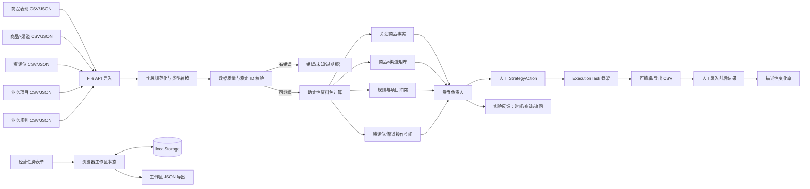
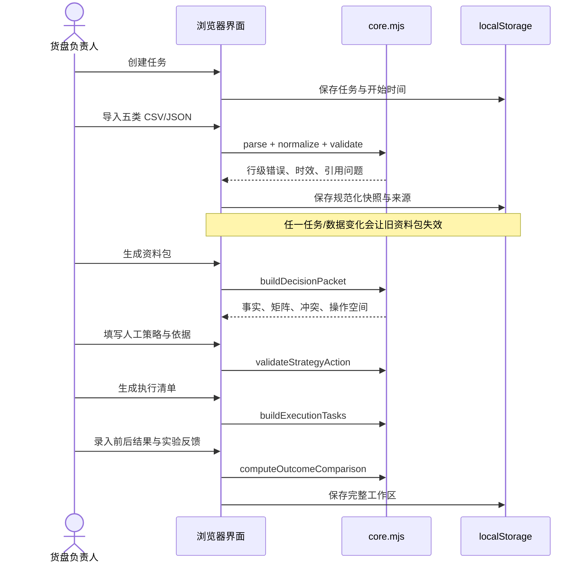

# 当前 MVP 实际架构

## 架构结论

这是一个**无后端、无构建、无第三方运行依赖的浏览器本地实验工具**。

它刻意没有数据库、账号体系、统一 API、数据中台、规则引擎、AI 推荐或任务中心。所有数据由用户主动导入，处理在浏览器中完成，工作区保存在 `localStorage`，并可导出 JSON 留档。

## 实际组件图



## 代码结构

```text
.
├─ index.html                 # 唯一入口
├─ styles.css                # 响应式工作台样式
├─ package.json              # start/test 命令，无依赖
├─ scripts/
│  └─ serve.mjs              # Node 内置模块静态服务器
├─ src/
│  ├─ app.js                 # 六步界面、文件导入、localStorage、导出
│  ├─ core.mjs               # 纯函数：CSV、规范化、校验、规则、清单、结果
│  └─ demo.mjs               # 明确标记的虚构 Demo 数据
├─ data/templates/           # 五类空 CSV 模板
├─ tests/
│  ├─ core.test.mjs          # 规则、关联、结果等核心测试
│  └─ static.test.mjs        # 静态入口与产品边界检查
└─ docs/                     # 问题、领域、实验、架构与发现
```

## 模块职责

### `src/core.mjs`

纯逻辑层，不依赖 DOM：

- 五类数据集 schema；
- CSV 解析与 CSV 导出；
- 字符串、数字、布尔、多值字段规范化；
- 必填、枚举、类型、复合主键校验；
- 数据时效和引用完整性检查；
- 7 类固定规则模板；
- 项目周期/区域/资源位锁定判断；
- 商品事实、渠道矩阵和操作空间计算；
- 人工策略动作校验；
- 策略 → 执行任务骨架；
- 描述性前后变化率和实验节省时间计算。

它不包含推荐、预测、模糊名称匹配或因果推断。

### `src/app.js`

界面与工作区编排：

- 六步导航；
- 经营任务创建；
- 单数据集 CSV/JSON 和整包 JSON 导入；
- Demo/真实/混合数据模式提示；
- 决策资料包渲染；
- 人工策略、执行清单、结果和实验反馈编辑；
- localStorage 持久化；
- 模板、执行清单和完整工作区导出。

所有导入内容经过 HTML 转义；没有远程脚本、字体或 API 请求。

### `src/demo.mjs`

生成虚构但结构完整的演示任务与五类数据。快照时间取加载 Demo 的当前时间，避免把演示数据的“新鲜”误当成真实业务新鲜度。界面始终显示演示模式警告。

### `scripts/serve.mjs`

使用 Node `http/fs/path` 内置模块提供静态文件，并阻止路径逃逸。无需 `npm install`。

## 数据流与失效规则



任务或任一数据集重新导入后：

- `packetGeneratedAt` 清空；
- 已生成执行清单清空；
- 人工策略可以保留以便重新评估，但必须重新生成资料包；
- 数据模式从 Demo + 真实导入变为“混合数据警告”。

## 规则实现边界

这不是通用规则引擎。`rule_type` 是有限枚举，对应代码中可测试的函数行为：

- 停售/待下架阻断；
- 库存低于数字阈值；
- 商品区域不包含任务区域；
- 商品渠道状态不是 online；
- 项目周期与任务重叠且锁定明确 slot；
- 任务声明保护新品；
- 清货商品/项目提示。

每条 finding 显示规则名称和具体字段证据。新增规则类型应先通过真实任务证明重复性，再写成新的确定性模板和测试。

## 存储与隐私

- 业务数据只保存在当前浏览器 `localStorage`，不自动上传。
- 刷新页面可恢复；清除站点数据或点击“清空本地数据”会删除。
- 工作区 JSON 是当前唯一备份/协作方式，包含导入数据和人工判断，应按业务数据安全要求保存。
- 这是单用户实验，没有登录、权限、审计、加密或并发编辑。
- 不应在共享电脑上导入敏感数据；真实上线前必须另行评估权限和数据安全。

## 可运行性与验证

```powershell
npm start
# 浏览器打开 http://127.0.0.1:4173

npm test
```

当前自动测试覆盖：

- CSV BOM、引号、逗号和转义；
- 类型与枚举问题；
- Demo 资料包生成；
- 停售、低库存、区域和项目锁定命中；
- 稳定 ID 关联不受商品改名影响；
- 未知引用和重复主键阻断；
- 人工策略冲突与执行清单；
- 前后变化只作描述性计算；
- HTML 入口无远程依赖和重复 ID。

## 当前已知限制

1. 没有 ProductIdentityLink 映射 UI；真实数据若没有统一 `product_id`，实验会暴露错误但不能在页面内修复。
2. 任务范围目前是文本 + 门店数，没有 `store_scope.csv`；跨源门店集合一致性仍需人工确认。
3. 商品表现宽表只有一个 `snapshot_at`，无法表达销量和库存来自不同时点。
4. “上线”尚未进一步拆成 listed/sellable；当前 enum 只能支持第一轮粗粒度确认。
5. 业务项目/规则缺失时允许带提醒生成资料包；真实实验必须由 Owner 判断能否继续。
6. 结果当前为人工录入，没有结果 CSV 导入。
7. localStorage 没有并发、审计、权限和版本合并。
8. 执行清单是一条策略对应一条任务，尚未验证是否需要一对多依赖步骤。

这些限制都在 `discovery-log.md` 中记录，不能被解释为“平台能力已经具备”。
