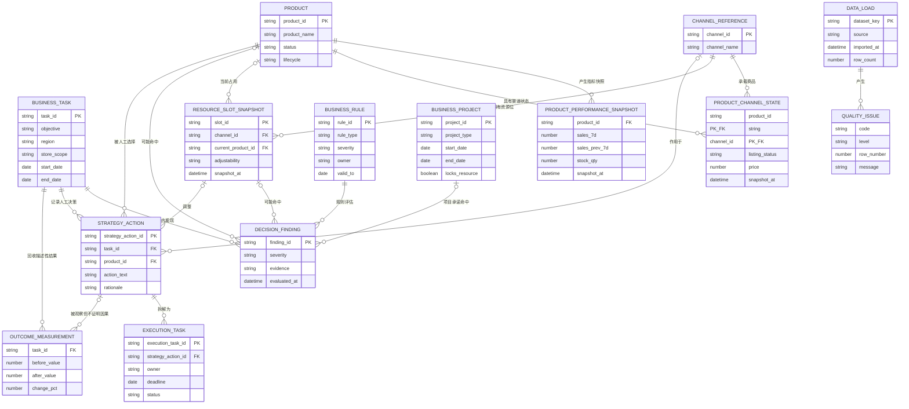

# 最小领域模型

## 建模原则

1. **任务有边界**：事实必须能回答区域/门店范围、时间窗、截至时间和来源。
2. **身份先于指标**：无法通过稳定 ID 关联的记录不能进入自动汇总，只能进入错误或未匹配清单。
3. **区分四层**：外部事实、业务规则/承诺、系统派生发现、人的经营判断。
4. **缺失不是否**：空值不能被解释成 0、未上线、无项目或无冲突。
5. **MVP 只保存快照**：不建设商品、资源位、项目或渠道“中心”。
6. **资料包不是权威数据源**：它是一次任务上的查询/投影视图。
7. **时效因数据而异**：销量、库存、渠道状态、资源位和规则分别显示快照年龄；代码中的阈值只是首轮默认值，应由实验修正。

## 对题目中候选对象的取舍

| 候选对象 | 取舍 | 理由 |
|---|---|---|
| `BusinessTask` | 保留 | 是范围、时间窗、目标、策略和结果的边界 |
| `Product` | 保留为逻辑身份 | 只存稳定 ID 与名称；当前物理输入与表现快照放在一张宽表，降低首轮导入成本 |
| `Channel` | 不单独建管理对象 | MVP 只需要薄字典，渠道 ID/名称从商品渠道状态和资源位快照中提取 |
| `ProductChannelState` | 保留 | 商品是否上线/可售、价格和渠道销量是跨渠道资料包的核心 |
| `ResourceSlot` | 改为 `ResourceSlotSnapshot` | 第一轮只需要本次任务看到的占用和锁定，不需要完整资源位中心 |
| `BusinessProject` | 保留为输入快照 | 项目周期和资源位承诺是冲突的重要来源，但不做项目管理 |
| `BusinessRule` | 保留有限模板 | 只支持 7 种确定性模板，不建立通用规则 DSL |
| `StrategyAction` | 保留 | 明确这是人的经营判断，不是系统推荐 |
| `ExecutionTask` | 保留 | 与策略分开，表达谁、何时、做到哪一步 |
| `Outcome` | 改为 `OutcomeMeasurement` | 只表达前后观测，不表达因果 |
| 新增 `DecisionFinding` | 派生对象 | 保存/展示规则命中、冲突、未知和证据，不是建议 |
| 新增 `DataLoad` / `QualityIssue` | 技术边界对象 | 用来区分未上传、已加载、过期、无效和真实 0 行 |
| 条件新增 `ProductIdentityLink` | 当前不实现 UI | 如果真实来源没有统一商品 ID，必须先做人工映射实验，而不是按名称模糊匹配 |

## 事实、规则、派生和人工判断

| 层 | 典型对象/字段 | 含义 |
|---|---|---|
| 外部事实 | Product、ProductPerformanceSnapshot、ProductChannelState、ResourceSlotSnapshot | 文件或系统在某时点的记录，必须带来源和时间 |
| 规则/承诺 | BusinessRule、BusinessProject 的锁定承诺 | 规范性规则或组织承诺，必须有 Owner 和有效期 |
| 系统派生 | trend、freshness、DecisionFinding、可操作空间 | 由明示公式/模板重算，不能写回为源事实 |
| 人工判断 | StrategyAction.rationale、例外说明、人工身份映射 | 人承担取舍和风险，需记录时间与依据 |
| 执行/结果事实 | ExecutionTask 状态、OutcomeMeasurement 前后值 | 描述动作实施和指标变化，不等于因果 |

## 对象说明

### 1. BusinessTask（经营任务）

- **真实业务事实**：一次有明确目标、范围、决策窗口和负责人的经营工作单元。
- **主键**：`task_id`，当前 MVP 由浏览器生成；外部任务号只能作为引用。
- **关系**：1:N StrategyAction、ExecutionTask、OutcomeMeasurement；所有 DecisionFinding 都在一个任务范围内产生。
- **事实字段**：`region`、`store_scope`、`start_date`、`end_date`、`owner`、任务状态。
- **人工判断/声明**：`objective`、`target_metric`、`target_delta_pct`、`protect_new`、`clearance_task`、备注。
- **来源**：负责人手工创建或经营 brief。
- **多久过期**：范围、目标或窗口一旦改变，现有资料包立即失效并重新生成。

### 2. Product（商品身份）

- **真实业务事实**：库存、渠道状态、资源位和动作共同指向的 canonical 商品；MVP 默认 SKU 粒度。
- **主键**：稳定 `product_id`，不能用展示名称代替。
- **关系**：1:N ProductPerformanceSnapshot、ProductChannelState；可被资源位、项目、策略和结果引用。
- **事实字段**：`product_name`、`category`、销售状态；生命周期若为人工分类，应记录来源。
- **人工判断**：对生命周期或“重点商品”的人工分类；当前 MVP 不生成重点标签。
- **来源**：商品主表，物理上暂时并入 `product_performance.csv`。
- **多久过期**：改名、改码、停售或生命周期变更时；每次任务重新导入易变字段。

### 3. ProductPerformanceSnapshot（商品表现快照）

- **真实业务事实**：商品在当前任务相关范围和明确窗口内的销量、库存、毛利与供应观测。
- **主键**：当前物理表用 `product_id` 表示每次导入的当前快照；长期系统应使用独立快照 ID。
- **关系**：N:1 Product；被任务范围筛选并产生趋势/库存发现。
- **事实字段**：`sales_7d`、`sales_prev_7d`、`stock_qty`、`gross_margin_pct`、`supply_status`、`allowed_regions`、`snapshot_at`。
- **人工判断**：无；`trend_pct`、低库存标签是派生。
- **来源**：`product_performance.csv/json`，可由销售、库存和商品表人工合成一次。
- **多久过期**：当前默认 48 小时；真实 SLA 是实验待验证项，库存通常比销量更快失效。

### 4. ChannelReference（渠道薄字典）

- **真实业务事实**：商品可以被上架/销售且资源位所属的经营触点。
- **主键**：稳定 `channel_id`，例如 `miniapp`、`groupbuy`、`delivery`。
- **关系**：1:N ProductChannelState、ResourceSlotSnapshot、StrategyAction。
- **事实字段**：`channel_name`。
- **人工判断**：无。
- **来源**：商品渠道状态和资源位输入中提取；名称冲突会报告。
- **多久过期**：渠道增删或改名时；首轮无需独立后台。

### 5. ProductChannelState（商品 × 渠道状态）

- **真实业务事实**：某商品在某渠道当前的上线状态、货盘、价格和销量。
- **主键**：复合键 `product_id + channel_id`（每次快照）。
- **关系**：N:1 Product、N:1 ChannelReference。
- **事实字段**：`listing_status`、`assortment_name`、`price`、`sales_7d`、`snapshot_at`。
- **人工判断**：“可补渠道”“值得上线”不是该对象字段，而是资料包中的操作空间和人的判断。
- **来源**：`product_channel_states.csv/json`，来自渠道导出或 Owner 确认快照。
- **多久过期**：当前默认 48 小时；状态或价格改变即失效。

### 6. ResourceSlotSnapshot（资源位快照）

- **真实业务事实**：一个资源位在某区域/渠道、某时点的当前商品与锁定状态。
- **主键**：`slot_id`；若各来源没有稳定 ID，需使用 `channel_id + source_slot_id + region` 的稳定组合。
- **关系**：N:1 ChannelReference，可选引用 Product；可被 BusinessProject 和 StrategyAction 引用。
- **事实字段**：`current_product_id`、`adjustability`、`lock_reason`、`available_from`、曝光/点击/转化、`owner`、`snapshot_at`。
- **人工判断**：如果“可调整”仅来自人工口头确认，应在来源中说明；系统不会从历史效率自动推荐替换。
- **来源**：一次性 `resource_slots.csv/json`。
- **多久过期**：当前默认 48 小时；排期或锁定变化即失效。曝光/点击/转化缺失不阻塞核心实验。

### 7. BusinessProject（当前业务项目快照）

- **真实业务事实**：在任务时间窗内可能保护商品、占用资源位或形成清货优先级的组织项目。
- **主键**：`project_id`。
- **关系**：通过 `product_ids`、`channel_ids`、`locked_slot_ids` 关联 Product、ChannelReference 和 ResourceSlotSnapshot。
- **事实字段**：`project_type`、`start_date`、`end_date`、`region`、`locks_resource`、关联 ID、`owner`、`snapshot_at`。
- **人工判断**：项目优先级之间如何取舍；项目存在与承诺是事实，是否改变策略由人决定。
- **来源**：`business_projects.csv/json`，来自项目表或项目 Owner 确认。
- **多久过期**：当前默认 7 天；项目周期、排期或锁定承诺变化即失效。

### 8. BusinessRule（有限模板规则）

- **真实业务事实**：在有效期内由明确 Owner 负责的规范性约束。
- **主键**：`rule_id`。
- **关系**：被规则评估器读取并生成 DecisionFinding。
- **事实字段**：`rule_type`、`severity`、`parameter`、`enabled`、`owner`、`valid_from/to`、`snapshot_at`。
- **人工判断**：规则严重度、例外和 Owner 确认。当前只支持 `STOP_SALE`、`LOW_STOCK`、`REGION_SCOPE`、`CHANNEL_OFFLINE`、`PROJECT_LOCK`、`NEW_PRODUCT_PROTECTION`、`CLEARANCE_VISIBILITY`。
- **来源**：`business_rules.csv/json`。
- **多久过期**：当前默认 7 天；到 `valid_to` 后不参与评估。无法结构化的规则应作为待确认事实，不可静默忽略。

### 9. DecisionFinding（决策发现，派生）

- **真实业务事实**：它不是新的源事实，而是规则对某任务中的商品、渠道或资源位产生的可解释评估结果。
- **主键**：当前运行时由规则、对象和顺序生成；长期可用 `task + rule + subject + input_version`。
- **关系**：N:1 BusinessTask、BusinessRule；可引用 Product、ChannelReference、ResourceSlotSnapshot、BusinessProject。
- **事实字段**：无源事实；包含 `severity`、`title`、`detail`、`evidence`、`source`、`evaluated_at`。
- **人工判断**：人的例外/覆盖不能删除原 finding，应另记原因。
- **来源**：确定性模板、缺失/时效/关联校验。
- **多久过期**：任一输入、任务边界或规则变化后立即失效并重算。

### 10. StrategyAction（策略动作）

- **真实业务事实**：负责人看完资料后作出的经营选择。
- **主键**：`strategy_action_id`。
- **关系**：N:1 BusinessTask/Product；可选 ChannelReference/ResourceSlotSnapshot；1:N ExecutionTask（当前 MVP 为 1:1）。
- **事实字段**：动作创建时间和状态。
- **人工判断**：`product_id`、`channel_id`、`slot_id`、`action_text`、`rationale`、建议 Owner/Deadline，全部由人填写。
- **来源**：货盘负责人。
- **多久过期**：被撤回、替换、完成或任务窗口结束；资料包重算后必须重新检查冲突。

### 11. ExecutionTask（执行任务）

- **真实业务事实**：把策略变成可分派和跟踪的执行承诺。
- **主键**：`execution_task_id`。
- **关系**：N:1 StrategyAction；当前 MVP 一条策略生成一条任务骨架。
- **事实字段**：`owner`、`deadline`、`status`、`updated_at`。
- **人工判断**：Owner 和 Deadline 由人确认，系统不猜组织责任；任务文字由模板派生。
- **来源**：StrategyAction + 人工补齐。
- **多久过期**：完成/取消前持续更新；逾期状态可派生但当前未自动告警。

### 12. OutcomeMeasurement（结果观测）

- **真实业务事实**：相同口径下任务范围、动作商品和其他商品的前后销量。
- **主键**：当前 MVP 与一个 BusinessTask 一起保存；长期应有独立观测 ID。
- **关系**：N:1 BusinessTask，可选关联 StrategyAction/Product。
- **事实字段**：`before_label/value`、`after_label/value`、`updated_at`。
- **人工判断**：口径说明与结果解释；`change_pct` 是派生值。
- **来源**：人工录入或未来结果 CSV。
- **多久过期**：窗口未完整时为 provisional；结算后应冻结版本。永远不等同于因果结果。

### 13. DataLoad / QualityIssue（数据装载与质量问题）

- **真实业务事实**：某数据集是否真的被加载、来自哪个文件、何时导入、有多少行。
- **主键**：当前工作区中的 `dataset_key`；质量问题由数据集/行号/错误码标识。
- **关系**：影响资料包可用性，但不参与业务策略本身。
- **事实字段**：`source`、`imported_at`、`row_count`、`mode`、错误/提醒。
- **人工判断**：负责人决定带着非阻塞提醒继续还是返回补数据。
- **来源**：浏览器导入流程。
- **多久过期**：重新导入即替换；工作区导出可留档。

### 条件对象：ProductIdentityLink（商品身份映射）

当前 MVP 要求五类输入已经使用同一个 canonical `product_id`，没有提供模糊名称匹配或映射审核 UI。如果真实文件做不到，下一轮应先增加：

- 复合主键：`source_system + source_product_id`；
- 映射目标：`product_id`；
- `match_method`、`confirmed_by`、`confirmed_at`、有效期；
- 所有一对多、未匹配和改码必须人工确认。

这不是“未来优化”，而是可能阻塞真实实验的首要数据假设。

## Mermaid ER 图

## 逻辑模型到当前文件的映射

| 逻辑对象 | 当前 MVP 物理实现 |
|---|---|
| Product + ProductPerformanceSnapshot | `product_performance.csv/json` 宽表 |
| ChannelReference | 从 `product_channel_states` 和 `resource_slots` 去重得到 |
| ProductChannelState | `product_channel_states.csv/json` |
| ResourceSlotSnapshot | `resource_slots.csv/json` |
| BusinessProject | `business_projects.csv/json` |
| BusinessRule | `business_rules.csv/json` |
| DecisionFinding | 浏览器运行时重算，不作为权威事实持久化 |
| BusinessTask / StrategyAction / ExecutionTask / OutcomeMeasurement | 浏览器 localStorage 与工作区 JSON |
| DataLoad / QualityIssue | localStorage 元数据与运行时校验报告 |

这个映射刻意保持扁平：先验证一次真实任务能否跑通，再决定是否值得规范化到数据库或 API。
