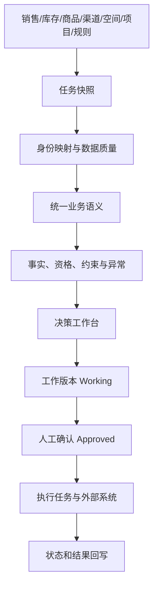

# 货盘经营决策基础：给产品经理的快速入门课

这份材料不要求你有零售、供应链或数据产品背景。读完后，你应该能做到三件事：

1. 听懂业务人员讨论“货盘、渠道、库存、资源位、选品、补货”时分别在说什么；
2. 判断一个产品需求是在处理事实、执行规则，还是试图替代人的经营判断；
3. 看出一个“智能经营”方案成立前，还缺哪些数据和业务前提。

建议第一次按顺序读。时间有限时，先读第 1、3、5、7、10 节。

---

## 1. 先建立一个最重要的心智模型

### 1.1 “货盘”不是仓库里的一堆货

在这个项目里，可以先把货盘理解为：

> 在特定时间、特定区域或门店、特定渠道中，准备销售或重点经营的一组商品，以及它们当时的可售状态。

因此，货盘不是只有一张商品清单。它至少同时受五个维度影响：

```text
商品 × 门店/区域 × 渠道 × 时间 × 状态与约束
```

同一个商品可能：

- 在华东可卖，在华南受区域限制；
- 在小程序已上线，在外卖未上线；
- 今天库存充足，三天后可能断货；
- 可以正常销售，但新品项目要求它必须占用首页资源位；
- 总销量很好，但只来自少数门店。

所以，“这个商品好不好”通常不是一个完整问题。更准确的问题是：

> 在这次经营目标、这个范围和这个时点下，它是否值得被关注？有哪些可行动空间？又有哪些风险？

### 1.2 用餐厅菜单来理解

可以把零售货盘想成一家连锁餐厅的菜单：

| 零售概念 | 餐厅类比 |
|---|---|
| Product / 商品 | “拿铁”这款产品 |
| SKU | 中杯热拿铁、大杯冰拿铁等具体可售单元 |
| Channel / 渠道 | 堂食、小程序、外卖平台 |
| Assortment / 货盘 | 某城市某渠道这一周实际提供的菜单 |
| Inventory / 库存 | 原料或可售成品，但要说明门店、时间和可用口径 |
| Resource Slot / 资源位 | 菜单头图、收银台推荐位、外卖首页位置 |
| Business Project / 业务项目 | 夏季新品推广、清库存专项 |
| Rule / 规则 | 售罄不能卖、区域限定、项目期内资源位不能撤 |
| Strategy Action / 策略动作 | 把某款新品加入外卖并放到首屏 |

这个类比也说明了为什么“自动选一个销量最高的商品”不等于经营决策：它可能缺货、不适合外卖、会挤占新品项目资源，或者只是把本来会买其他咖啡的人转移了过来。

### 1.3 整个产品只需先记住四句话

1. **销量是已经发生的交易，不完全等于真实需求。** 缺货、未上线和没有曝光都会压低观察到的销量。
2. **库存必须带商品、地点、时间和口径。** 单独一个“库存 100”几乎无法支持经营判断。
3. **事实、规则、系统发现和人工判断是四种不同的信息。** 系统发现一个机会或冲突，不等于系统已经做出经营决定。
4. **动作前后一起发生的变化，不自动证明因果。** 还可能同时受到天气、活动、价格、竞争和自然趋势影响。

在此基础上，早期产品的价值不是算出“最优答案”，而是让人更快拿到完整、可信、可行动的决策上下文。

---

## 2. 用一个任务走完全过程

假设经营任务是：

> 未来 7 天，华东 120 家门店整体销量提升 8%；同时保护新品，并完成一项清货任务。

一个专业的货盘负责人不会马上回答“推商品 A”。他实际需要依次回答五类问题。

### 第一步：目标到底是什么

- “整体销量”是销售件数、订单数还是销售额？
- 以哪 120 家店为范围？中途新开或闭店怎么算？
- 对比基准是前 7 天、去年同期还是计划值？
- 除了 +8%，毛利、缺货率、新品曝光是否不能恶化？

如果这些没有定义，后续任何分析都可能答非所问。

### 第二步：当前发生了什么

- 哪些商品近期卖得多、增长快或明显下滑？
- 哪些结果可能受缺货、停售、低曝光影响？
- 商品在小程序、团购、外卖分别是否上线？
- 库存、供应和生命周期处于什么状态？

这是**事实准备**，原则上应由系统尽量完成。

### 第三步：哪些事情能动，哪些不能动

- 哪些渠道尚未上线，但本周来得及上线？
- 哪些资源位可调整，哪些被项目锁定？
- 哪些商品库存不足，不能扩大曝光？
- 哪些区域限制或停售规则会阻止动作？

这是**资格、约束与可操作空间检查**，确定性较强，也适合系统完成。

### 第四步：究竟采取什么策略

负责人可能选择：

- 商品 A 上线外卖，但不增加首页资源；
- 商品 B 保留小程序曝光，因为处于新品保护期；
- 商品 C 参加团购清货；
- 不调整商品 D，虽然它增长快，但库存不能支撑。

这是**经营判断**。它包含目标权衡、经验、风险偏好和组织承诺，现阶段应由人负责，并记录依据。

### 第五步：动作是否执行，结果如何

- 谁负责上线商品、调整资源位、准备库存？
- 截止时间是什么？是否真的完成？
- 动作商品、其他商品和门店整体分别发生了什么变化？

这是**执行闭环和描述性复盘**。前后变化只能说明“同时发生了什么”，不能自动证明“变化由这个动作造成”。

完整链路可以表示为：


---

## 3. 货盘领域最容易混淆的概念

### 3.1 商品、SPU 和 SKU

- **Product / SPU**：一类商品概念，例如某款运动鞋。
- **SKU**：真正可以独立定价、计库存和销售的最小单元，例如黑色 42 码。

在食品或简单零售场景，Product 与 SKU 可能看起来相同；在服装、3C 等行业，两者差别很大。本 MVP 暂时把 `product_id` 当作可经营的最小稳定商品身份，真实试点前必须确认它究竟是 SPU 还是 SKU。

### 3.2 货盘、选品、品类管理和商品计划

这些词相关，但不是同一件事：

**品类 / Category** 是消费者眼中可以共同满足某类需求的一组商品，例如即饮咖啡、早餐或家庭清洁。企业内部也可能按组织和采购结构划分，因此品类边界不是天然唯一的。品类负责人管理的通常不是一个 SKU，而是一组商品怎样共同完成销量、毛利、流量或形象目标。

| 概念 | 主要回答的问题 |
|---|---|
| 选品 | 这次要考虑或引入哪些商品？ |
| 货盘 / Assortment | 在某范围和渠道中，实际经营哪些商品组合？ |
| 品类管理 / Category Management | 这个品类扮演什么角色，应该用商品、价格、促销、陈列等哪些战术？ |
| 商品计划 / Merchandise Planning | 销售、毛利、库存和采购预算如何分配与达成？ |
| 分货 / Allocation | 已有库存应该先分到哪些门店或仓？ |
| 补货 / Replenishment | 何时、向哪里、补多少货？ |

“提升销量”并不必然要改货盘，也可能通过价格、促销、陈列、补货或门店执行改善。货盘只是经营战术之一，不是经营策略的全部。

### 3.3 渠道与商品渠道状态

渠道可以是小程序、团购、外卖、门店等销售触点。同一 SKU 在每个渠道上可能有不同的：

- 上下架状态；
- 售价和活动价；
- 可售区域；
- 可共享库存比例；
- 渠道商品 ID；
- 销售表现。

因此，`Product` 与 `ProductChannelState` 必须分开。把“是否外卖上线”直接塞进商品主表，看起来简单，渠道一多就会失控。

还要注意：**已上线不一定等于可售**。商品可能已经创建，但因无库存、配送范围、价格配置、审核或停售状态而无法真正下单。

### 3.4 库存不是一个数字

业务口中的“库存”至少可能指：

- 实物库存：仓库或门店实际有多少；
- 可用库存：扣除已占用、锁定、残次等后还能承诺多少；
- 在途库存：已经采购或调拨，但还没到；
- 渠道可售库存：按渠道共享和锁定规则计算出的可售量；
- 区域汇总库存：若干仓店的聚合值。

所以字段只写 `inventory = 100` 几乎没有业务意义。至少还需知道：

```text
哪个商品 + 哪个仓/店/区域 + 什么库存口径 + 截至什么时间 + 来自哪个系统
```

### 3.5 资源位、陈列和 Planogram

- **资源位**：小程序首页坑位、团购会场、外卖金刚区，也可能是线下端架或收银台陈列位。
- **Planogram / 货架图**：规定线下商品如何摆放、占多少面宽的空间方案。

资源位“存在”不等于“可以调整”。还要确认：当前占用、锁定原因、生效周期、负责人，以及在任务时间窗内是否来得及变更。

“资源位”也不是一个天然统一的对象。真实试点前应明确本次实验只覆盖数字运营位、线下物理陈列位，还是两者都覆盖；二者的状态来源和执行方式通常完全不同。

### 3.6 生命周期

常见阶段包括新品、成长期、成熟期、衰退期、清退期。生命周期不是纯粹由销售曲线自动推断的自然事实，很多时候也包含公司的人工定义和项目承诺。

例如“新品保护 14 天”是业务政策；“最近 7 天销量增长 30%”才是观察事实。两者不能混写成同一个标签。

### 3.7 门店集群

成熟零售系统不会永远逐店规划，也不会给全国所有店同一货盘，而是把需求、客群、面积或商圈相似的门店组成集群。集群能减少规划复杂度，但只有当门店数据足够稳定时才有意义。MVP 可以先使用业务已知的区域或门店组，不必急着做聚类算法。

---

## 4. 看懂系统版图：每类系统各自负责什么

企业里经常不是“没有系统”，而是各系统只保存了问题的一部分。

| 系统 | 主要职责 | 通常不能单独回答什么 |
|---|---|---|
| PIM / 商品中心 | 商品编码、名称、属性、类目、图片 | 商品在各渠道此刻是否可售、实际库存和经营判断 |
| ERP | 采购、交易、财务、主数据等企业资源事实 | 面向一次经营任务组织完整决策上下文 |
| WMS | 仓储、库位、批次、出入库和实物库存 | 为什么要推某商品、资源位是否应调整 |
| OMS | 各渠道订单与履约状态 | 未发生订单的需求、品类策略和线下空间 |
| 渠道后台 | 本渠道商品、价格、活动、订单和流量 | 跨渠道统一视图 |
| BI | 汇总指标、报表、看板和自助分析 | 把人的决定变成任务并追踪执行，通常也不保存决策依据 |
| 计划系统 | 预测、货盘、空间、采购、分货或补货计划 | 若基础身份和数据口径不可靠，结果也不会可靠 |
| 决策工作台 | 围绕一个目标拼装事实、约束、判断、版本和执行 | 不应替代前面的交易与库存事实系统 |

本项目更像一个**薄的、任务型决策工作台**：不重建 ERP、WMS、BI 或数据中台，而是在一次任务范围内把它们的必要事实和未知项组织起来。

### 看板与决策资料包的区别

| 通用看板 | 决策资料包 |
|---|---|
| 长期监控固定指标 | 服务于一次明确任务 |
| 经常展示“全局发生了什么” | 说明“此次范围内哪些事实影响选择” |
| 数据持续刷新 | 应冻结任务时点或版本，保证可复盘 |
| 由用户自己寻找异常 | 主动呈现相关冲突、缺失和可操作空间 |
| 通常不记录最后为何决定 | 保存人工策略、依据、版本和执行状态 |

如果 MVP 最终只是多做了一张大屏，它很可能没有减少经营人员在系统之间确认信息的成本。

---

## 5. 四层信息必须严格分开

这是理解本产品最关键的一节。

| 层次 | 例子 | 谁产生 | 能否直接代表决策 |
|---|---|---|---|
| 源事实 | SKU A 近 7 天销量 120；截至 10:00 可用库存 8 | 业务系统或导入数据 | 不能 |
| 业务规则/承诺 | 可用库存低于 10 不允许扩大曝光；新品位锁定至周日 | 业务负责人、制度或项目 | 不能 |
| 系统发现 | SKU A 命中低库存规则；资源位 R1 被新品项目占用 | 确定性计算 | 不能 |
| 人工判断 | 暂不扩大外卖曝光，保留小程序位置，并优先补货 | 货盘负责人 | 是，仍需确认与执行 |

同一个案例可以拆成：

```text
事实：商品 A 最近增长 25%，外卖未上线，可用库存只有 8 件。
规则：库存低于 10 件不建议扩大曝光。
发现：外卖存在覆盖空白，但同时存在库存风险。
判断：本周不上外卖，先由供应负责人确认两天内能否补货。
```

这里最重要的不是系统“推荐不上外卖”，而是它把机会和冲突同时摆在了人面前。

### 两类“问题”也必须区分

**数据质量问题**决定资料能否被信任：

- 商品 ID 无法关联；
- 库存快照已经过期；
- 一个渠道出现重复记录；
- 必填字段为空；
- 120 家门店只匹配到 107 家。

**业务限制或冲突**决定动作能否被采取：

- 商品停售；
- 库存不足；
- 区域受限；
- 资源位锁定；
- 新品保护与清货任务冲突。

前者是“证据不可靠”，后者是“事实可靠，但经营上有限制”。把两者都显示成一个红色告警，会让使用者无法采取正确行动。

---

## 6. 数据为什么看似都有，却仍然拼不起来

判断一项数据能否用于决策，至少检查五件事。

### 6.1 身份是否一致

商品中心可能使用 `SKU-001`，外卖平台使用 `W-8842`，Excel 里只有“低糖拿铁”。名称并不是可靠主键，因为会改名、重名、加规格或写错字。

理想情况是共享稳定商品 ID；做不到时，需要显式的 `ProductIdentityLink` 映射，并把无法匹配的记录交给人确认，不能静默猜测。

### 6.2 粒度是否一致

粒度是“一行数据究竟代表什么”。例如：

- 销量：商品 × 区域 × 7 天；
- 库存：商品 × 仓库 × 某一时点；
- 渠道状态：商品 × 渠道 × 区域；
- 资源位：位置 × 门店或渠道 × 生效周期。

把区域 7 天销量和全国实时库存直接相除，虽然能算出数字，却没有稳定业务意义。

### 6.3 时间是否对齐

销量截止昨天 24:00，库存截止今天 10:00，渠道状态来自三周前手工表。它们可以展示在同一页，但必须标出各自的 `as_of`，并提示陈旧程度。

### 6.4 定义是否一致

“销量”可能是支付件数、下单件数、出库件数或扣除退款后的净销量；“上线”可能是已创建商品、用户可见或真的可下单。名称相同不代表定义相同。

### 6.5 来源和加工过程是否可追溯

用户看到“趋势 +22%”时，应能知道：来自哪个文件或系统、比较哪两个区间、是否排除闭店、使用什么公式。这个链路称为数据血缘或来源追踪。

可以把数据可信度记成一个简单公式：

```text
可用证据 = 身份对齐 × 粒度对齐 × 时间可接受 × 定义一致 × 来源可追溯
```

这里使用乘号是为了强调：其中一项为零，漂亮的图表也可能没有决策价值。

### “未知”不是“否”

`channel_state` 缺失可能意味着没有上线，也可能意味着这批数据没覆盖该渠道。系统必须把 `未知`、`未上线`、`已上线` 分开。把空值当作“否”是经营系统中很危险的捷径。

---

## 7. 需要会看的基础指标

指标的价值不在公式本身，而在它回答哪个问题，以及分母和范围是否一致。

### 7.1 销量与销售额

- 销量：销售件数；
- 销售额：数量 × 实际成交价，通常还需明确是否含税、是否扣退款。

销量增长不一定带来利润增长；降价可能提高销量同时降低毛利。

### 7.2 增长率 / 趋势

```text
增长率 =（本期值 - 对比期值）/ 对比期值
```

必须注明本期、对比期和异常因素。基数很小时，增长率会非常夸张。

### 7.3 毛利和毛利率

```text
毛利 = 销售收入 - 商品成本
毛利率 = 毛利 / 销售收入
```

实际企业可能还会纳入平台佣金、履约或促销成本。不要假定各部门的“毛利”定义完全相同。

### 7.4 售罄率 / Sell-through

常见简化定义是：

```text
期间售罄率 ≈ 期间销量 /（期间销量 + 期末库存）
```

企业口径差异很大，有的分母使用期初库存或到货量。引用前先问清定义。

### 7.5 库存可售天数 / Days of Supply

```text
可售天数 ≈ 当前可用库存 / 近期平均日销量
```

它只能在商品、地点和库存口径一致时使用。新品没有稳定日销、活动会改变需求、长期缺货会压低历史销量，都会让结果失真。

### 7.6 缺货率与可得率

它们回答“顾客想买时是否能买到”。只看销售结果看不到被缺货压掉的需求，因此成熟系统会把可得性与销量一起看。

### 7.7 渠道覆盖率

可定义为某商品已上线渠道数 / 目标渠道数，或已覆盖门店数 / 目标门店数。它只能说明覆盖缺口，不能证明增加覆盖一定会有增量。

### 7.8 曝光、点击和转化

```text
点击率 = 点击 / 曝光
转化率 = 成交 / 点击（或访客，需说明口径）
```

这些指标帮助判断资源位表现，但资源位之间的流量质量并不相同，不能只按转化率机械交换。

### 7.9 增量和蚕食

- **增量**：某动作真正带来的额外结果；
- **蚕食**：新商品或新渠道的增长，只是把原来属于其他商品或渠道的销量转移过来。

这两者需要对照、实验或更强模型才能估计。MVP 展示“动作前后变化”即可，不能把相关变化直接称为增量。

一个很重要的近似关系是：

```text
观察销量 ≈ 真实需求受到库存、上线状态、价格、曝光与执行影响后的结果
```

所以销量是重要事实，但不是完整的需求真相。

---

## 8. 什么才算“经营判断”

经营判断不是神秘直觉，它通常是多目标权衡：

- 销量与毛利；
- 短期增长与长期新品培育；
- 清库存与品牌/价格体系；
- 区域统一与门店差异；
- 机会大小与执行成本；
- 预期收益与断货、投诉、项目冲突风险。

系统可以准备证据、检查确定性规则、模拟场景，但它很难在没有明确授权的情况下替企业决定这些权衡。

因此，人工填写“判断依据”不是多余表单，而是未来最有价值的数据之一。它能帮助团队回答：

- 当时掌握了哪些证据？
- 哪条规则被接受或人工覆盖？
- 为什么没有选择看起来最明显的商品？
- 同类任务中人的判断是否稳定？
- 将来哪些部分可能安全地被自动化？

---

## 9. 成熟系统为什么通常长成这种架构

Oracle、RELEX、Blue Yonder 等成熟产品，以及国内的 BI、零售和供应链产品，侧重点不同，但共同模式大致是：



每一层解决的问题不同：

- **任务快照**：保证复盘时知道当时看到了什么；
- **身份与质量**：保证表能正确关联，未知不会被伪装成事实；
- **业务语义**：让“商品、渠道、门店、资源位、项目”有稳定含义；
- **事实与约束**：把数据加工成与任务有关的可解释发现；
- **工作版本**：允许人修改、比较和补充依据；
- **确认版本**：明确哪一版可以进入执行；
- **回写**：区分“决定了”“任务已发出”和“现场真的完成了”。

### 为什么不直接照搬成熟平台

成熟套件通常假设企业已经有：

- 稳定的商品和门店主数据；
- 足够细、足够长的历史；
- 比较一致的库存、渠道和空间数据；
- 专职规划角色与明确流程；
- 持续维护规则和模型的团队。

当前最需要验证的恰好是这些前提是否存在，以及自动准备资料能否产生净收益。过早建设预测、优化器、统一中台或通用规则平台，会把未经验证的业务问题变成昂贵的技术项目。

---

## 10. AI 应该按什么顺序进入

可以把能力分成五级：

| 级别 | 系统能力 | 例子 | 当前是否适合 |
|---|---|---|---|
| L0 事实整理 | 关联、聚合、展示、标明来源和时点 | 生成商品 × 渠道矩阵 | 是 |
| L1 确定性检查 | 按明确规则识别资格、冲突和缺失 | 停售、低库存、资源位锁定 | 是 |
| L2 场景计算 | 比较人提出的多个动作版本 | 若上架 A，需要哪些任务和资源 | 以后可试 |
| L3 建议与排序 | 根据历史和约束给候选方案 | 建议关注某商品并解释证据 | 需先验证数据与接受度 |
| L4 自动决策与执行 | 系统直接决定并写回业务系统 | 自动上下架、自动改资源位 | 当前不适合 |

语言模型在早期也可以有辅助价值，例如：

- 把非结构化项目说明整理成待人工确认的规则草稿；
- 生成资料包摘要，但链接回原始事实；
- 检查人工策略是否缺 Owner、Deadline 或依据；
- 帮助解释字段和异常。

但它不应凭缺失数据猜库存、猜业务规则，或把“渠道未上线”自动解释成“应该上线”。

### 当前 MVP 中哪些只是实验性简化

为了让第一轮实验能运行，页面和导入模板刻意压缩了一些真实复杂度。理解这些边界很重要：

- `stock_qty` 只是简化库存值，不代表长期模型只需一个库存字段；真实试点要补范围、口径、来源和时点；
- 商品表现表暂以 `product_id` 关联，但一条表现记录的完整身份其实还包括门店/区域范围、统计窗口和截至时间；
- `lifecycle` 可能来自商品系统，也可能是人工经营标签，真实数据必须标注来源；
- 任务中的“保护新品”“存在清货任务”如果只是勾选项，只能算人工声明；若公司有正式项目，应关联对应项目及有效期；
- “华东 / 120 家门店”目前是任务描述，若各来源匹配出的门店集合不同，就必须升级成明确的门店清单或门店组；
- 渠道矩阵只证明某种渠道状态，不能单独证明库存、配送和价格均满足实际履约。

这些不是要求第一轮立刻建设完整主数据，而是提醒我们不要把实验模板误认为已经验证过的正式领域标准。

---

## 11. 怎样判断当前 MVP 是否真的有价值

核心假设不是“用户喜欢这个页面”，而是：

> 系统自动准备决策资料后，货盘负责人能否以更少的搜集、拼接和确认成本，完成质量不下降的经营判断。

一次真实实验至少记录：

### 效率

- 使用前后，准备一次任务各花多长时间；
- 要打开多少系统、Excel 和群聊；
- 需要向多少人追问；
- 导入、清洗和修正模板又花了多长时间。

要比较的是**净节省时间**，不是页面生成速度。

### 完整性与可信度

- 关键事实遗漏多少；
- 有多少商品或门店无法关联；
- 有多少数据过期或定义不清；
- 系统发现的规则冲突中，哪些是真问题、哪些是误报；
- 使用者是否愿意依据资料包行动。

### 决策与执行

- 最终策略是否能在时间窗内执行；
- 生成的执行任务是否准确、责任是否清楚；
- 人工判断依据是否能在复盘时被理解；
- 哪些信息最终没有影响任何决策，可以下次删除。

结果指标可以收集，但第一次实验不要用销量是否上涨来单独判断产品价值，因为市场、天气、促销、节假日、竞争和供应变化都会同时影响结果。

---

## 12. 产品经理最应该追问的 12 个问题

以后听到任何“智能货盘”“经营大脑”方案，都可以先问：

1. 这次经营目标的指标、范围、时间窗和对比基准是什么？
2. 这里的商品身份是 SPU、SKU，还是渠道商品？
3. 每张表一行代表什么粒度？
4. 数据截至什么时间，多久会失效？
5. “库存”“销量”“上线”等字段的业务定义是什么？
6. 商品、门店和渠道如何跨系统关联？匹配不上的怎么办？
7. 哪些是源事实，哪些是人工填写或算法推导？
8. 规则由谁维护，适用范围和生效期是什么？
9. 系统展示的是业务限制，还是数据本身不可信？
10. 看到一个机会后，本周真的有资源和权限执行吗？
11. 人最终决定了什么，为什么，哪一版获准执行？
12. 结果回收是在描述变化，还是有足够证据讨论因果？

如果一个方案无法回答前 10 个问题，就不应该急着讨论预测准确率或 AI 自动决策。

---

## 13. 一页术语速查

| 术语 | 小白版解释 |
|---|---|
| Assortment | 某范围、渠道和时间内实际经营的商品组合，接近本项目中的“货盘” |
| Listing | 商品在某渠道/门店具备售卖资格或已经上架的状态 |
| Availability | 顾客需要时商品是否真的可买到 |
| Lifecycle | 新品、成长、成熟、衰退、清退等经营阶段 |
| Width / Breadth | 货盘覆盖多少种不同选择或细分类别 |
| Depth | 某类商品有多少规格、款式或库存深度；企业口径可能不同 |
| ROS / Rate of Sales | 单位时间销售速度，例如日均销量 |
| Sell-through | 一段时间内已有货品被卖掉的比例，必须确认分母口径 |
| Days of Supply | 按当前销售速度估算库存还能支撑多少天 |
| OOS / Stockout | 缺货，导致顾客需求无法成交 |
| Cannibalization | 新动作的销售来自其他商品/渠道被转移，而非净增长 |
| Incrementality | 动作相对“不做”真正多带来的结果 |
| Store Cluster | 需求或经营特征相似的一组门店 |
| Planogram | 线下货架商品位置和空间分配图 |
| Snapshot | 某个时点冻结的数据版本 |
| Source of Truth | 某类事实被组织认可的权威来源 |
| Data Lineage | 一个指标从哪个来源、经过什么加工而来 |
| Semantic Layer | 把不同表翻译成稳定业务对象、关系和指标定义的一层 |
| Exception | 正常规则以外、需要人工确认或批准的特殊情况 |
| Scenario / Version | 尚未执行的方案或计划版本，用于比较和审批 |
| Writeback | 把人的决定、执行状态或结果写回系统形成闭环 |

---

## 14. 推荐学习顺序

不需要一开始学习预测算法、运筹优化或数据中台。更高效的顺序是：

1. **先掌握本页第 1—7 节**：能区分商品、渠道、库存、资源位、规则和指标；
2. **实际走一遍当前 MVP**：看每一步分别减少了什么人工工作；
3. **阅读领域模型**：理解为什么事实、发现、判断和执行被拆成不同对象；
4. **阅读国内外方案研究**：带着“它解决的是哪一层”去看，而不是被平台功能数量带走；
5. **找一名真实货盘人员访谈**：让他用最近一次任务逐项指出信息来源、等待、返工和判断点；
6. **拿一批真实但脱敏的数据跑实验**：实际暴露 ID、口径、时效和规则维护问题；
7. **有了多次任务记录后**，再讨论场景比较、建议排序、预测或自动化。

推荐配套阅读：

- [问题理解](problem-understanding.md)
- [最小领域模型](domain-model.md)
- [MVP 实验设计](mvp-experiment.md)
- [国内外相邻产品、方法与开源架构研究](landscape-research.md)
- [实现发现日志](discovery-log.md)

---

## 最后的判断标准

一个好的早期版本不需要显得“智能”，但必须让使用者清楚地回答：

> 我正在为什么目标做判断；我看到的事实来自哪里、截至何时；哪些信息缺失或冲突；哪些事情本周真的能动；最后是我基于什么依据做了什么决定。

如果这个闭环成立，系统才有资格逐步学习人的判断并增加智能。如果这个闭环不成立，越复杂的 AI 只会更快地产生看似专业、实际上无法验证的答案。
