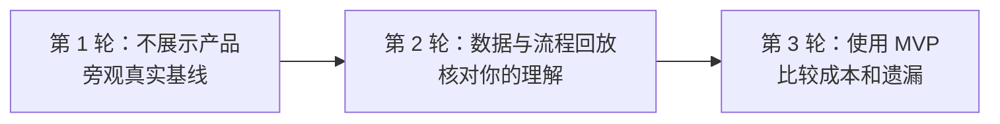

# 货盘团队现场旁观手册：给产品经理小白的情境研究课

这份手册用于第一次走到真实货盘负责人身边，旁观他如何完成一项经营任务。它不是传统的“需求访谈提纲”，而是一套尽量减少误判的现场工作研究方法。

配套记录表：[现场观察记录模板](field-observation-template.md)

---

## 1. 先理解：你去现场究竟要研究什么

你不是去问：

> 你想要什么功能？你会不会使用我们的产品？

你真正要研究的是：

> 当一个真实经营目标到来后，他怎样把不完整的信息变成一个可以执行的决定？过程中花了什么成本、依赖了谁、有哪些不确定性、哪些部分真的需要人的判断？

### 观察对象应是一项真实任务，而不是“这个岗位”

“请介绍一下你平时怎么工作”得到的通常是整理过的标准流程。更有效的观察单位是：

> 一名真实负责人 + 一项正在发生的任务 + 一个明确起点和结果。

例如：

> 华东 120 家门店未来 7 天整体销量希望提升 8%，同时保护新品并完成清货任务。请按平时的方法处理，我在旁边观察。

尽量选择：

- 真任务，而不是为你专门编的演示任务；
- 有正常截止时间，但不是正在救火的最高风险任务；
- 会涉及至少两类数据和一名协作者；
- 能观察到“资料准备—判断—交接”中的大部分过程；
- 不含你没有权限接触的顾客个人信息或高度敏感商业数据。

### 第一次研究要验证的核心问题

围绕当前项目，第一轮只需集中验证六件事：

1. 资料准备真的是主要成本吗？具体耗在哪一步？
2. 完成判断必须使用哪些事实，哪些只是“有更好、没有也能做”？
3. 商品、门店和渠道能否跨系统稳定关联？
4. 规则在哪里，谁知道，多久变化，哪些允许例外？
5. 负责人真正做了哪些取舍，而不是机械套规则？
6. 决定形成后，在目标时间窗内能否执行？

---

## 2. 什么才算“有效信息输入”

现场输入的可信度并不相同。建议按下面的证据阶梯理解：

| 证据强度 | 输入类型 | 示例 |
|---|---|---|
| 1，最强 | 当前真实任务中的直接观察 | 负责人现场切换 4 个系统，用 VLOOKUP 对齐商品，再在群里等库存确认 |
| 2 | 可核验的工作痕迹 | 脱敏表格、导出文件、消息时间、任务单、版本记录、系统截图 |
| 3 | 最近一次具体事件的回放 | “打开上周那次任务给我看，你当时为什么改了这三个商品？” |
| 4 | 对日常工作的概括 | “我们通常都会检查库存” |
| 5，最弱 | 假设性意见或未来偏好 | “如果有 AI 自动推荐，我应该会用” |

低等级证据不是毫无价值，但不能单独支持高成本产品决策。

### 三种输入必须分开记录

1. **他说了什么**：原话、规则描述、理由；
2. **他做了什么**：点击、复制、搜索、联系、等待、判断、返工；
3. **留下了什么痕迹**：表格、字段、消息、系统状态、任务和结果。

一个典型差异可能是：

```text
他说：库存我们在系统里都能看到。
你看到：系统库存是昨天的，他又去群里问仓库今天还能发多少。
工作痕迹：群消息 18 分钟后回复“其中 300 件已被其他活动锁定”。
```

真正的发现不是“有库存系统”，而是“系统库存不能直接代表这次任务可用的库存，负责人需要额外确认占用情况”。

### 观察、解释和假设不能混写

推荐使用六个标签：

- `[O] Observation`：你直接看到或听到的；
- `[A] Artifact`：文件、页面、消息、日志等可核验痕迹；
- `[Q] Quote`：尽量保持原文的业务人员说法；
- `[R] Reported`：参与者对过去事情的回忆，暂时没有材料佐证；
- `[I] Interpretation`：你对现象的解释；
- `[H] Hypothesis`：仍需其他任务验证的假设。

示例：

```text
[O] 10:14 打开“外卖在线商品 1017.xlsx”，按名称查找商品 A，没有找到。
[Q] “可能在外卖那边改过名字，我问一下渠道同学。”
[O] 10:17 发群消息，10:31 得到渠道商品 ID。
[A] 群消息和渠道文件使用了两个不同商品 ID。
[I] 跨渠道身份映射依赖人工确认。
[H] 这可能是该团队资料准备时间的主要来源之一；需再观察至少两个任务。
```

这样会阻止你把一次偶发现象直接写成“用户都需要商品映射中心”。

---

## 3. 正确的研究顺序：先看基线，再测产品

不要一到现场就先展示原型。原型会提醒对方按照你的字段和流程思考，从而污染你想观察的真实基线。

建议分三轮：



### 第 1 轮：基线旁观

目标是还原他今天真实使用的工具、信息源、协作和判断过程。此时不要帮他整理数据，也不要暗示系统应该怎样做。

### 第 2 轮：回放核对

你把观察到的流程、数据源和关键判断画出来，让负责人纠错：

- 哪一步看错了？
- 哪个动作只是偶发？
- 哪条规则漏了？
- 哪些等待发生在屏幕之外？
- 哪些信息因为你在场而没有按平时方式获取？

### 第 3 轮：MVP 共用测试

再用相似任务或同一任务的数据重放当前 MVP，比较：

- 主动操作时间是否下降；
- 等待时间是否只是被隐藏；
- 需要追问的人数是否减少；
- 关键事实和冲突是否遗漏；
- 导入、清洗和修正模板增加了多少成本；
- 人是否仍能理解和控制最后的策略。

这三轮可以在不同日期完成。最重要的是不要把“原型演示很顺”误认为“原流程成本已经被降低”。

---

## 4. 去之前如何准备

### 4.1 找对人

首轮主观察对象应是亲自形成货盘动作方案的人，而不是只负责汇报的人。还可以短暂访谈：

- 给任务的人：目标从哪里来、怎样算完成；
- 商品或渠道运营：商品状态与渠道动作；
- 供应链或库存负责人：库存口径与供应承诺；
- 项目/营销负责人：新品、清货和资源位承诺；
- 执行人：收到策略后怎样落地。

不要一开始安排大型多人会议。群体场景容易只得到组织认可的“标准流程”，看不到个人实际绕路。

### 4.2 发一段不带答案的邀请说明

可以直接使用：

> 我们正在了解货盘同学接到经营目标后，真实怎样收集信息、形成判断并推动执行。这次不是考核你，也不是评审系统。希望旁观一项正在发生的任务，请按平时方式操作；遇到敏感数据可以随时停下或遮挡。我会记录动作和耗时，并在事后请你核对，不会未经同意传播原始截图或数据。

### 4.3 明确权限和隐私边界

提前确认：

- 能否看屏幕、拍照、录屏或录音；没有明确同意就不要记录；
- 哪些字段必须脱敏，如顾客信息、供应商报价、门店利润；
- 哪些文件只能看不能带走；
- 研究输出发给谁审核；
- 对方任何时候都可以暂停。

优先记录结构、动作、耗时和数据口径，不要为了研究便利复制不必要的真实业务数据。

### 4.4 准备你的假设清单，而不是功能清单

可以把假设写成“如果不成立，产品就要改变”的句子：

| 假设 | 现场要找的证据 |
|---|---|
| 资料准备是主要成本 | 各阶段主动操作、等待、追问和返工分钟数 |
| 必要数据能够取得 | 来源、Owner、权限、导出方式和获得周期 |
| 商品可以稳定关联 | 实际使用的 ID、名称匹配、歧义和人工确认 |
| 规则能被显式表达 | 规则来源、适用范围、有效期、例外与 Owner |
| 资料包能减少成本 | 使用前后的净操作时间与遗漏，而非页面加载速度 |
| 决策能在窗口内执行 | 最近动作的审批、配置、上线和确认周期 |

### 4.5 现场工具

最低配置即可：

- 一份打印或电子版记录模板；
- 可精确到分钟的时钟；
- 便利贴或简单画图工具；
- 经同意后的截图/录音方式；
- 一个“稍后追问区”，避免每个细节都打断工作。

如果允许，两个人去最好：一人观察和提问，一人计时和记行为。只有你一人时，优先保证时间线和证据，不要追求逐字稿。

---

## 5. 一次现场旁观怎么安排

真实任务可能跨数小时或数天，不必从头到尾坐在旁边。第一次可以这样安排：

| 阶段 | 建议时间 | 目的 |
|---|---:|---|
| 开场与任务定界 | 10–15 分钟 | 明确目标、起点、截止时间、预期交付物 |
| 安静旁观主要工作 | 60–120 分钟 | 记录正常动作、工具、切换、等待、协作和判断 |
| 关键节点追问 | 穿插，每次 30–90 秒 | 理解刚发生的选择，不打断工作节奏 |
| 当日回放 | 20–30 分钟 | 补全屏幕外动作、判断依据和未知项 |
| 后续状态检查 | 每次 10–20 分钟 | 跟进审批、执行与结果，避免只看到“方案写完” |

### 开场只问五件事

1. 这项任务是谁、通过什么方式交给你的？
2. 你怎样理解它的目标、范围和截止时间？
3. 最后要交付什么，谁会使用？
4. 你觉得怎样才算完成得好？
5. 预计会依赖哪些人或系统？

问完后就让他按正常方式开始。不要立即把你的领域模型逐项念给他听。

---

## 6. 现场到底观察什么

可以把一次任务分成九段。不是所有团队都按此顺序工作；顺序发生跳跃，本身也是重要发现。

| 阶段 | 重点观察 | 可能暴露的问题 |
|---|---|---|
| 1. 目标进入 | 来源、指标、时间窗、门店范围、模糊处 | 目标本身需要大量澄清 |
| 2. 范围确认 | 门店清单、区域定义、商品或品类边界 | 各系统中的“华东”不是同一集合 |
| 3. 找资料 | 打开哪些系统/文件、找谁、等多久 | 信息分散、权限或 Owner 不清 |
| 4. 拼接与校验 | 使用什么 ID、怎样处理空值、重复和过期 | 人工匹配、静默猜测、口径冲突 |
| 5. 识别机会与风险 | 看哪些指标、怎样筛选关注商品 | 规则与个人经验混杂 |
| 6. 做取舍 | 比较过哪些方案、为什么放弃某方案 | 真正需要人的目标权衡 |
| 7. 协调与批准 | 找谁确认、谁有否决权、是否留下版本 | 隐形审批和项目承诺 |
| 8. 转成执行 | 动作怎样拆任务、Owner、Deadline、系统入口 | 策略与执行不是一一对应 |
| 9. 结果回收 | 谁确认已完成、何时看结果、怎样解释变化 | 没有执行回写或错误归因 |

### 每一步都记录七类信息

1. **触发**：为什么现在做这一步；
2. **动作**：点击、复制、计算、搜索、联系或判断；
3. **输入**：哪个数字、文件、消息或经验；
4. **输出**：新增了什么结论、表格或任务；
5. **成本**：主动操作时间、等待时间、返工次数；
6. **不确定性**：哪里不知道、过期、口径不清或需要确认；
7. **依据**：为什么选择这个动作而不是另一种。

### 货盘场景中特别要盯住的细节

- 他依据商品名称还是稳定 SKU ID 找同一商品？
- “销量”是哪个范围、周期和口径？
- “库存”是实物、可用、在途还是渠道可售库存？
- “上线”是商品已创建、用户可见，还是确实可下单？
- 门店集合怎样确定，各系统覆盖的是否是同一批店？
- 新品保护、清货、停售和区域限制在哪里记录？
- 哪些规则是文件里的，哪些只存在某个人脑中或群聊里？
- 资源位是数字运营位还是线下陈列位，状态由谁确认？
- 他看到渠道空白时，是否自然认为这是机会，还是会先检查履约和审批？
- 他最后的判断里，哪些证据出现在正式交付物中，哪些只停留在脑中？
- 方案写完后，谁把它变成多个具体动作？
- “任务已发出”和“现场已完成”由什么证据区分？

---

## 7. 怎样提问才不会把人带偏

最有价值的提问紧跟刚发生的行为，并要求具体证据。

### 推荐问题

#### 理解动作

- “你刚才为什么先打开这张表？”
- “你在这一列找什么信号？”
- “如果没有这个数字，你还能继续吗？”
- “你怎样确认这两个系统里是同一个商品？”

#### 理解来源与可信度

- “这个数字来自哪里？截至什么时候？”
- “多旧的数据你还愿意用？超过多久必须重新确认？”
- “这个空白表示没有，还是目前不知道？”
- “如果两个来源不一致，你通常信哪一个？为什么？”

#### 理解规则与例外

- “这是一条正式规则，还是这次项目的约定？”
- “谁能修改或批准例外？”
- “最近一次没有按这条规则做是什么情况？能回看一下吗？”

#### 理解经营判断

- “你刚才考虑过哪些选择？”
- “为什么最后没选另一个商品/渠道？”
- “这里是在套规则，还是你做了权衡？”
- “为了这个目标，什么指标可以牺牲，什么绝对不能牺牲？”

#### 理解执行

- “这个决定接下来具体由谁做什么？”
- “怎样知道已经真正上线，而不是只发出了任务？”
- “最近一次类似动作从提出到完成花了多久？”

### 尽量不要这样问

| 引导性或低价值问法 | 为什么不好 | 更好的问法 |
|---|---|---|
| “数据很分散，是不是很麻烦？” | 已经替对方定义了问题 | “为了得到这个结论，你刚才经过了哪些来源？” |
| “你是不是需要一张统一看板？” | 把解决方案塞进问题 | “哪一步最耗主动操作，哪一步最耗等待？” |
| “如果 AI 自动推荐你会用吗？” | 假设性回答几乎没有购买或使用承诺 | “最近一次你接受或拒绝某个建议时，依据是什么？” |
| “你们平时都怎么做？” | 容易得到制度化概括 | “请打开最近一次真实任务，从收到目标开始回放。” |
| “库存规则是不是 10 件？” | 把你的 Demo 规则当成现实 | “什么情况下你会认为库存不足？谁定义？” |
| “这个功能有用吗？” | 礼貌性肯定很常见 | 让他用真实任务完成，再比较耗时、遗漏和信任 |

### 不要每一步都追问

连续打断会把真实工作变成教学演示。做法是：

- 对低风险细节先记到“稍后追问区”；
- 只在发生选择、异常、返工或等待时短问一句；
- 一个工作段结束后再集中回放；
- 遇到对方明显进入专注状态时保持安静。

---

## 8. 时间应该怎样记录

“这件事花了两天”信息不够，因为两天中可能只有 40 分钟主动操作，其余都在等待别人。

至少区分：

- **主动操作时间**：找数、导出、复制、清洗、计算、核对、写方案；
- **等待时间**：等待权限、数据导出、他人回复或审批；
- **判断时间**：比较方案、做权衡、写依据；
- **返工时间**：因为口径、ID、版本或规则错误而重做；
- **执行周期**：决定确认后到真实上线/调整完成。

示例：

```text
任务端到端 3 小时 25 分钟
├─ 主动资料准备 47 分钟
├─ 等待库存确认 96 分钟
├─ 经营判断 18 分钟
├─ 返工 14 分钟
└─ 其他并行工作，不计入主动时间
```

这会导向不同产品结论：主动拼表高，可能适合自动整理；等待高，可能先需要明确 Owner 和交付 SLA；判断高，不一定应该自动化，可能需要更好的证据组织。

---

## 9. 现场结束后怎样把记录变成产品知识

### 9.1 30 分钟内重建原始时间线

离开现场后尽快补全：

- 每个动作的开始、结束和等待；
- 使用过的系统、文件和联系人；
- 关键原话；
- 你没看懂、需要复核的地方；
- 对方因你在场而可能改变的行为。

先保留“不整齐的现实”，不要急着把流程画成理想直线。

### 9.2 用证据链表达发现

每个发现都按下面格式写：

```text
问题：跨渠道商品身份不能直接关联。
证据：在 10:14—10:31，负责人因商品名称不同无法确认外卖状态，发消息给渠道同学并等待 14 分钟；文件中存在两个相似名称。
解释：当前流程依赖渠道人员维护在脑中的映射关系。
影响：可能增加等待，也可能把错误状态关联到错误商品。
触及假设：不同来源能够使用稳定 product_id 关联。
暂定产品响应：首轮先要求显式 ID 映射和未匹配阻断，不自动按名称猜测。
下一步验证：再抽两个任务各 30—50 个 SKU，统计精确匹配、一对多和未匹配。
信心：中；当前只观察到一个任务。
```

不要只写“用户痛点：数据分散”。那无法告诉团队该解决什么，也无法证明问题重要。

### 9.3 给问题排序

可以分别按 1—3 分评估：

- **频率**：一次任务发生几次、多少人遇到；
- **时间成本**：主动时间、等待和返工；
- **决策风险**：会不会导致错品、漏规则、不可执行；
- **可解决性**：当前团队能否用小实验改善。

不要把四项机械相加得出“科学排名”。分数的作用是迫使团队说明为什么优先，而不是制造精确幻觉。

### 9.4 输出六张最小成果

一次旁观后，建议形成：

1. **真实任务时间线**：发生过的动作和等待；
2. **信息源地图**：系统/文件、Owner、粒度、时点、导出方式；
3. **规则与未知清单**：正式规则、口头约定、例外和无人确认项；
4. **决策点清单**：人在哪些地方做了取舍，依据是什么；
5. **执行交接图**：决定如何变成任务，怎样确认完成；
6. **假设更新表**：哪些得到支持、被推翻、仍需验证。

### 9.5 把一次观察当线索，不当结论

一次真实任务非常适合发现阻塞，但不适合证明频率。建议至少完成三个任务：

- 一个相对常规任务；
- 一个受新品或营销项目影响的任务；
- 一个库存紧张、清货或异常较多的任务。

三个任务出现的共同问题，才更适合进入 MVP 主流程；只在一人一次任务中出现的情况，先作为例外或待验证项保存。

这三个任务适合做第一轮方向判断，不足以证明整个团队的发生频率。若要为正式投入做判断，建议逐步扩展到 4—6 位实际操作者、6—10 个任务，并刻意覆盖资深与较新同学、常规与紧急任务、顺利与被阻塞任务。资深人员可能依靠记忆跳过步骤，只看最熟练的人会低估真实学习与确认成本。

---

## 10. 怎样与当前 MVP 做一次有效对比实验

完成基线旁观后，可以用下一项相似任务测试当前 MVP。

### 先共同确认门槛

例如：

- 资料准备主动时间相对基线下降至少 30%；
- 关键停售、库存、区域和项目限制不能漏报；
- 不允许出现静默商品错配；
- 导入和模板维护时间必须计入总成本；
- 人仍能看到来源、未知项并控制最终策略。

这些是实验建议，不是已经验证的业务标准，应由真实负责人一起确认。

### 同时记录系统外成本

MVP 页面可能 5 分钟就生成资料包，但数据 Owner 用了 2 小时填模板。真实净收益应计算：

```text
净节省 = 原流程全部相关成本 - 新流程全部相关成本
```

新流程成本包括：

- 找数据 Owner；
- 导出和脱敏；
- 填模板、清洗和改 ID；
- 导入与修错；
- 业务人员额外确认；
- 资料包阅读与人工判断。

### 观察使用者是否真的信任资料包

不要只问“你信不信”。看行为：

- 他是否又回原系统重复查一遍？
- 哪些字段一定要二次确认？
- 他是否能解释冲突为什么出现？
- 他是否敢根据资料包形成任务？
- 当系统与经验冲突时，他怎样处理？

重复查询本身就是很重要的信任信号。

---

## 11. 初学者最常犯的错误

1. **一开始就展示原型**：会让对方按你的框架表演工作。
2. **只访谈，不观察**：人很难准确回忆所有切换、等待和隐性判断。
3. **把抱怨直接变成功能**：“Excel 麻烦”不自动等于要建数据中台。
4. **只记用户说法，不记时间和痕迹**：无法判断频率、成本和真实性。
5. **一直问为什么**：容易像质问；可以改问“当时你掌握了什么”“你怎样知道”。
6. **替对方操作**：你会不小心消除原流程真实摩擦。
7. **只观察资料准备，不跟到执行**：可能整理出一份正确但根本无法落地的资料包。
8. **把一次任务推广到所有人**：先记录信心和待验证范围。
9. **忽略沉默的参与者**：真正掌握库存、规则或审批的人可能不在现场。
10. **只测总耗时**：必须拆开主动操作、等待、判断和返工。
11. **把前后销量变化当产品成功**：首轮应先验证准备成本、完整性和信任。
12. **回到办公室后立即加功能**：先让业务人员核对你的流程和解释。

---

## 12. 你可以直接照着执行的首轮计划

### 第 0 天：准备

- 找到一名真实货盘负责人和一项中等复杂度任务；
- 取得观察与材料使用许可；
- 写下六个核心假设；
- 不提前展示 MVP；
- 建立空白观察模板。

### 第 1 天：基线旁观

- 10—15 分钟定界；
- 60—120 分钟安静旁观和计时；
- 20—30 分钟回放；
- 约定后续执行状态确认时间。

### 当天：整理

- 30 分钟内补时间线；
- 将 `[O]/[Q]` 与 `[I]/[H]` 分开；
- 建信息源、规则、决策点和执行清单；
- 只写有证据的发现。

### 第 2 天：业务核对

- 用 20—30 分钟让负责人纠错；
- 询问哪些是偶发、哪些可复现；
- 明确缺失材料和后续跟进人。

### 第 3—7 天：跟执行

- 记录审批、配置、上线、失败和返工；
- 区分“已决定、已派发、已完成”；
- 回收描述性结果，但不声称因果。

### 下一个相似任务：MVP 对比

- 使用真实脱敏输入；
- 把所有模板准备和清洗成本算进去；
- 比较时间、追问、遗漏、错配与重复确认；
- 决定下一轮是补数据、删字段、改流程，还是停止扩展。

---

## 最后的心法

你不是去证明“货盘决策助手值得做”，而是去寻找什么证据会让它值得做，什么证据会迫使我们缩小、改变甚至停止当前方案。

一次好的现场研究结束后，你不一定得到更多功能需求，但应该更清楚：

- 哪些工作是真实反复发生的；
- 哪些成本来自信息处理，哪些来自组织等待；
- 哪些规则可被系统检查，哪些仍需要人协商；
- 哪些判断有证据链，哪些主要依靠经验；
- 一个最小产品究竟应减少哪一段成本。

这比收集一份“用户希望功能列表”更接近产品发现的本质。
