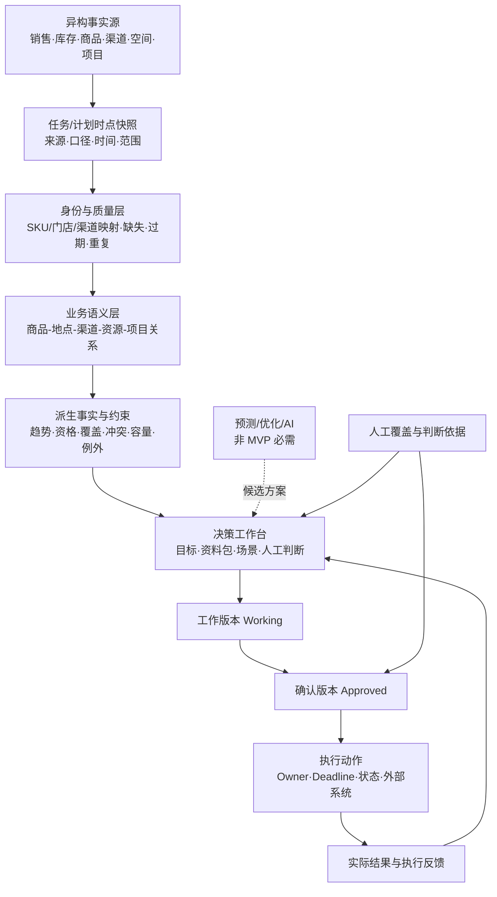

# 国内外相邻产品、方法与开源架构研究

> 调研日期：2026-10-18  
> 研究目的：不是证明“市场上有人做过，所以我们也该做”，而是借已有产品和方法识别这个问题的成熟结构、常见前提与不应过早建设的能力。

## 1. 结论先行

有很多团队解决过这个问题的**一部分**，但在本轮可查的公开资料中，没有发现一个产品完整对应当前设想的这条链路：

`经营目标 → 临时汇集跨系统事实 → 暴露未知与冲突 → 人工经营判断 → 执行清单 → 描述性结果回收`

市场上的方案大致分成四类：

| 类别 | 代表 | 主要解决什么 | 与本项目的关系 |
|---|---|---|---|
| 零售经营方法 | ECR Category Management | 从品类定义、目标、策略到战术、执行和复盘 | 帮助避免把“调整货盘”误当成经营策略本身 |
| 成熟零售计划套件 | Oracle Retail、RELEX、Blue Yonder、SAP、NIQ | 门店/集群级货盘、空间、库存、补货和财务计划 | 最接近完整业务闭环，但通常假设主数据和历史数据已经可用 |
| 国内经营与交易产品 | 观远、瓴羊、有赞、微盟、聚水潭、杉数、生意参谋 | 多源分析、全渠道商品/库存、门店执行或预测优化 | 分别覆盖资料准备、事实系统和自动优化，鲜少覆盖任务级人工判断工作台 |
| 开源积木 | Saleor、ERPNext、OpenBoxes、DuckDB、dbt、Evidence 等 | 商品渠道模型、库存事实、数据处理、质量和展示 | 可以借鉴分层或局部引入，没有可直接部署的完整同类产品 |

最重要的市场判断是：

> 成熟产品大多从“数据已经进入计划系统”开始；本项目试图解决的，恰恰是数据进入正式计划之前的决策准备问题。

因此，更准确的产品定位不是“轻量版 Oracle/RELEX”，也不是“AI 自动选品”，而可能是：

> **面向一次经营任务的决策准备层（decision-readiness layer）**：把散落事实、数据质量、业务限制、可操作空间和人工判断装进一个可追溯的任务闭环。

这个切口是否成立仍需真实任务验证，但它与成熟套件并不完全重叠。

## 2. 成熟方案的共同架构

不同厂商名称很多，但底层模式高度一致：



横向贯穿这条链路的不是“大模型”，而是六个基础能力：

1. 稳定且可关联的身份；
2. 数据来源、口径、范围和更新时间；
3. 数据错误与业务冲突分层；
4. 可解释的规则证据和人工例外；
5. 工作版本、确认版本和执行记录；
6. 结果回写，但不把相关性自动解释为因果。

## 3. 海外最值得研究的方案

### 3.1 ECR Category Management：先定义经营问题，再决定货盘战术

ECR 的经典流程将战略对齐、品类洞察/定义、品类角色、评估、目标、战术、实施和绩效复盘连成循环。货盘只是战术之一，还要与价格、促销、呈现和供应共同考虑。

**值得学：** 创建任务时不能只有“销量 +8%”，还应逐步确认目标商品群/品类、品类角色、允许使用的战术、不可牺牲指标和复盘时间。  
**不该抄：** 不要把完整八步法做成强制的大型流程；先验证哪几个上下文字段会真实改变负责人判断。

资料：[ECR 八步法介绍](https://www.ecr-community.org/new-catmannetwork-webinar-series-step-1-2/)、[Day-to-Day Category Management Guide](https://www.ecr-community.org/wp-content/uploads/2020/11/CatMan2000.pdf)

### 3.2 Oracle Retail：资格、例外、人工覆盖与明确批准

Oracle 的流程将历史、预测、财务目标、商品资格、门店集群和例外放入同一个工作台。系统可以生成候选货盘和销售潜力，规划者可以覆盖推荐、处理例外，最终把 Working Plan 批准为 Current Plan；之后再进入商品 × 地点的销售、到货和库存计划。

**最值得学：**

- `Item Eligibility`：先判断是否具备采取动作的资格；
- `Store / Item Exceptions`：例外不是备注，而是正式对象；
- `Working → Approved`：草稿和确认版本不能混在一起；
- planner 可以覆盖系统建议，但必须留下依据。

**不该抄：** 多层工作簿、预测平台、复杂商品层级和管理配置远超当前实验需要。

资料：[Oracle Assortment Planning 介绍](https://docs.oracle.com/en/industries/retail/retail-assortment-planning-cloud-service/24.2.401.0/apcsu/to_introduction.htm)、[Oracle Planning & Optimization](https://www.oracle.com/retail/planning-optimization/)

### 3.3 RELEX：货盘不能脱离空间、库存和补货可执行性

RELEX 将品类目标、商品表现、需求预测、门店/渠道、空间、库存和补货连接起来。系统识别强弱 SKU、重复商品并模拟货盘表现，人调整商品组合；变化可继续传递给预测、补货、货架图和库存计划，门店也可以反馈局部例外。

**值得学：** “值得关注”不能只看销量；候选动作至少要同时展示库存、渠道状态、资源位和项目承诺。  
**不该抄：** 门店级预测、自动货架图和补货优化需要远超 MVP 的数据基础。

资料：[RELEX Assortment Planning](https://www.relexsolutions.com/solutions/assortment-planning-software/)

### 3.4 Blue Yonder：人定义策略参数，系统做规模化计算

Blue Yonder 的典型模式是：行为相近的门店先分群，规划人员定义策略参数和业务规则，系统结合表现与物理空间批量形成门店级候选货盘，再进入空间、货架图、分配和补货流程。

**值得学：** 业务规则先做成少量明确参数，不必一开始建设通用规则语言；“资源位能否执行”应在决策前出现。  
**不该抄：** 复杂聚类和全自动门店组合只有在门店级事实长期稳定后才有意义。

资料：[Blue Yonder Assortment Planning](https://blueyonder.com/solutions/retail-planning/assortment)、[Retail Planning & Category Management](https://info.blueyonder.com/retail-planning-category-management)

### 3.5 SAP：计划版本、层级和计划—实际对比

SAP 将组织、门店组、品类和商品等层级纳入规划，支持计划、历史、实际以及多个测试版本的比较。确认后的计划可以连接 listing、allocation、promotion 和 workflow。

**值得学：** 不覆盖原方案；至少保留输入快照、人工草稿、确认策略和实际结果。指标必须带粒度与时间窗口。  
**不该抄：** 当前不需要 SAP 式主数据、BW 或完整工作流体系。

资料：[SAP Merchandise and Assortment Planning](https://help.sap.com/docs/SAP_ERP_SPV/82265744ff764efb8b48ef431235214c/ebdcc353b677b44ce10000000a174cb4.html)、[SAP Assortment Management and Listing](https://help.sap.com/docs/SAP_S4HANA_ON-PREMISE/9905622a5c1f49ba84e9076fc83a9c2c/ac72a957487fb576e10000000a4450e5.html)

### 3.6 NielsenIQ：低销量不等于应该退出

NIQ 的货盘与空间优化会研究需求转移、商品增量贡献以及 add/drop/swap 场景。它提醒我们：移除一个低销量 SKU 后，需求可能转给本品类其他商品，也可能流失给竞争对手；新品销量也可能只是蚕食旧品。

**值得学：** 将来应优先做“可比较场景”，而不是输出唯一最优答案。  
**不该抄：** 没有足够长的门店 × SKU 历史和真实上下架样本时，不能用简单相关性冒充增量模型。

资料：[NIQ Retail / Assortment & Space](https://nielseniq.com/global/en/industries/retail/)

### 3.7 Palantir Foundry：事实、关系、动作和回写属于同一个模型

Palantir 不是零售货盘产品，但其 Ontology 架构很值得借鉴：Objects 表达商品、门店、项目和任务；Relations 表达它们的关系；Actions 表达可执行变化；Functions/Rules 表达逻辑；人的动作与结果通过 writeback 成为新的业务事实。

**值得学：** 当前系统可以是一层“微型 Ontology”——事实对象、关系、规则证据、人工动作、执行结果彼此可追溯。  
**不该抄：** 不要建设企业知识图谱或统一语义平台；稳定 ID 和几张关系表已经足够验证第一轮价值。

资料：[Palantir Foundry Ontology](https://www.palantir.com/explore/platforms/foundry/ontology/)、[Ontology 文档](https://www.palantir.com/docs/foundry/ontology)

## 4. 国内最值得研究的邻近产品

公开材料中也没有发现一对一同类。国内方案大致分布在三层：

```text
交易与执行事实层：有赞 / 微盟 / 聚水潭
                  ↓
数据准备与经营洞察层：观远 / 瓴羊 / 生意参谋
                  ↓
预测与优化决策层：杉数科技
```

### 4.1 观远数据：最接近“多源事实 → 可行动洞察”

观远聚合商品、渠道、门店和库存数据，再提供商品 ABC、畅滞销、动销率、门店差异、库存健康和预警等分析。它更接近一个角色化 BI/分析平台，而不是任务级策略工作台。

**值得学：** 从数据准备、可靠指标、异常提示逐步走向行动；不同角色看到不同决策资料。  
**不该抄：** 不为本次实验建设通用 ETL、指标平台、数据门户和自由分析系统。

资料：[观远零售行业方案](https://www.guandata.com/m/solution?tag=retail)、[观远 5A 产品思路](https://www.guandata.com/rids/)

### 4.2 瓴羊 Quick BI + Dataphin：企业级分层参照

相关案例体现的是：数据治理层先统一销售、订单、物流、商品和库存，再由分析层和模型层形成洞察或建议，最后送进门店/顾问的工作场景。

**值得学：** 数据底座、业务语义、决策界面与执行角色应分层；建议停在驾驶舱里没有闭环价值。  
**不该抄：** 成熟集团的数据中台规模不是单次 MVP 的前置条件。

资料：[瓴羊产品矩阵与经营参谋](https://www.lydaas.com/conference2022)、[Quick BI](https://www.lydaas.com/quickbi)

### 4.3 有赞：母商品、渠道商品和库存的领域模型

有赞的业务结构说明同一个母商品进入不同门店、网店或外部渠道后，会拥有渠道级的上下架、价格、配送和库存状态；商品分析再从销量、金额、流量、动销和异常等角度辅助人工经营。

**值得学：** `Product` 与 `ProductChannelState` 应分开；上下架、价格和渠道库存不是 Product 的静态字段。  
**不该抄：** 当前不应扩成 ERP/OMS/WMS，也不必追求实时库存共享。

资料：[有赞商品分析](https://help.youzan.com/displaylist/detail_5_5-2-25678)、[有赞单品分析](https://help.youzan.com/displaylist/detail_4_4-2-13460)

### 4.4 微盟：统一事实以后，真正闭环仍发生在门店作业

微盟的全渠道零售方案连接商品、价格、库存、订单以及门店移动作业。值得注意的是，其帮助材料也暴露了名称关联导致重复或错配的现实风险。

**值得学：** 策略之后必须落成门店/渠道人员可完成并回报的动作；商品、价格、库存和订单是不同事实域。  
**不该抄：** 不复制会员、营销、收银、履约和 CRM 全家桶，也不能把商品名称当跨渠道主键。

资料：[微盟智慧零售](https://www.weimob.com/website/topic/retail)、[微盟商超方案](https://www.weimob.com/zhsc)

### 4.5 聚水潭：库存不是一个数字

聚水潭在中央商品与平台商品之间维护映射，并按规则同步渠道库存。其公开文档揭示了关键事实：可用库存可能由实物库存、订单占用、虚拟库存、在途、进货仓和销退仓等共同计算。

**值得学：** `stock_qty` 必须同时说明口径、区域/仓范围、时间点和来源；在口径未知时，低库存规则不可信。  
**不该抄：** 第一轮不需要渠道 API 网络和实时事件总线，带时间戳的快照即可。

资料：[聚水潭开放平台](https://isv-openweb.jushuitan.com/index)

### 4.6 杉数科技：远期的预测、仿真与优化参照

杉数的方案更接近 `数据 → 预测 → 运筹优化 → 多方案仿真/比较 → 人发布计划 → 跟踪`，应用在需求、库存、补货和供应计划。

**值得学：** 即使未来进入智能推荐，也应提供目标、约束、多个版本、人工发布和事后跟踪。  
**不该抄：** 商品关联、库存口径和规则尚不稳定时，引入预测或求解器只会规模化错误。

资料：[华为云 × 杉数供应链智慧决策方案](https://www.huaweicloud.com/solution/retail/iscpps.html)

### 4.7 生意参谋 / 京东商智：围绕目标组织单平台经营事实

平台型经营工具会将流量、交易、商品、行业和活动数据整理成商品表现、异常、机会和过程监控，商家据此调整货品、渠道和预算。

**值得学：** 资料包应围绕本次目标组织事实，而不是继续堆排行榜；执行中可以监控，但不能把同时发生的销量变化自动归因给某个动作。  
**不该抄：** 单平台口径不能代表小程序、外卖、门店和团购的全渠道事实。

资料：[京东商智官方学习中心](https://xue.jd.com/ondemandCourse/searchOndemandCoursePage.action?courseName=%E4%BA%AC%E4%B8%9C%E5%95%86%E6%99%BA)、[京东商机中心介绍](https://mtt.m.jd.com/video/1606896867)

## 5. 最值得看的开源项目

没有一个开源项目能直接替代当前产品。值得研究的是各层的模型和实现方式。

| 项目 | 对应层 | 值得借鉴 | 当前建议 |
|---|---|---|---|
| [Saleor](https://github.com/saleor/saleor) / [Channels](https://docs.saleor.io/developer/channels/overview) | 商品 × 渠道 | Product/Variant、Channel Listing、Warehouse Stock 分离；渠道控制可见性、可售性、价格和仓覆盖 | **看领域模型，不部署** |
| [ERPNext](https://github.com/frappe/erpnext) / [Item](https://docs.frappe.io/erpnext/item) | 商品、库存、单据 | 稳定 Item Code、Item × Warehouse 库存、草稿与提交动作分离 | **只学对象和状态** |
| [OpenBoxes](https://github.com/openboxes/openboxes) / [Features](https://openboxes.com/features/) | 仓储事实 | 库存快照、移动流水、批次/效期、请求量、实际发出量分离 | **只学库存口径与审计** |
| [DuckDB](https://github.com/duckdb/duckdb) / [CSV](https://duckdb.org/docs/current/data/csv/overview) | 本地文件分析 | 进程内查询 CSV/JSON/Parquet，Excel 扩展，无需独立数据库服务；可保留 raw 表和规范化视图 | **最可能的下一步技术升级** |
| [dbt Core](https://github.com/dbt-labs/dbt-core) / [Data Tests](https://docs.getdbt.com/docs/build/data-tests) | 转换、质量、血缘 | raw → staging → marts；unique/not-null/accepted-values/relationships 测试；转换可版本化 | **有中心数据库和重复任务后再引入** |
| [Great Expectations](https://github.com/great-expectations/great_expectations) | 数据质量 | Batch、Expectation、Validation Result、Checkpoint；把“不可信”与“业务冲突”分开 | **先借思路，当前校验代码足够** |
| [Evidence](https://github.com/evidence-dev/evidence) | 决策资料包 | SQL + Markdown 的叙事型、可版本化报告，比通用大屏更接近“本次任务资料包” | **值得做一个输出形式实验** |
| [Metabase](https://github.com/metabase/metabase) | 自助 BI | 适合资料包之外的大量临时追问和自由探索 | **出现持续探索需求后再部署** |
| [json-rules-engine](https://github.com/CacheControl/json-rules-engine) | 确定性规则 | 规则、Facts、Events、优先级分离，可借鉴规则 ID、范围、版本和证据结构 | **现在不引入规则引擎** |
| [frePPLe](https://github.com/frePPLe/frepple) | 约束式供应计划 | 预测、产能/交期约束和计划求解 | **只作为远期研究，不进入 MVP** |

开源路线的合理组合不是“把这些全部装起来”，而是按出现的问题逐层升级：

```text
当前：浏览器 + CSV/JSON + 明确 schema + 固定规则
  ↓ 当文件量/行数/关联复杂度明显上升
DuckDB：保留 raw 输入，以 SQL 生成任务事实视图
  ↓ 当数据源固定、多人复用、每日重复运行
dbt / 专门质量层：转换、测试、血缘、版本
  ↓ 当临时追问成为主要需求
Evidence 或 Metabase：叙事报告 / 自助探索
  ↓ 当规则规模与维护人显著增长
规则版本与管理能力
```

## 6. 这次调研对当前产品的直接影响

### 6.1 当前产品边界得到支持

Oracle、RELEX、Blue Yonder 等成熟方案仍然保留 planner 的目标设置、例外处理、覆盖、批准和复盘。自动化主要承担数据拼接、规模化计算、资格/约束检查和场景模拟。因此，“系统准备信息，人负责经营判断”不是保守过度，而是一个成立的人机分工起点。

### 6.2 当前真正可能形成差异的位置

成熟套件通常假设：

- 商品、门店、渠道身份已经统一；
- 销量、库存、价格和资源空间有固定数据源；
- 规则已经被配置；
- 规划人员进入系统时，资料已经可用于计划。

当前用户的问题发生在这些条件成立之前。因此产品应优先把以下内容当作一等对象：

- 缺了什么；
- 哪份数据过期；
- 哪两个 ID 不能确认是同一商品；
- 哪条规则是谁说的、何时失效；
- 哪个结论只是人工确认；
- 负责人为何带着某个未知继续决策。

换句话说，第一阶段的核心资产不是推荐模型，而是**决策证据链**。

### 6.3 对领域模型的建议，但暂不扩大实现

真实实验后应优先评估是否需要增加或强化以下对象：

| 候选对象 | 为什么值得考虑 | 何时才加入 |
|---|---|---|
| `InputBatch / DataSnapshot` | 保留文件、来源、口径、范围、导入时间和数据时间 | 第一次真实导入即验证 |
| `DataQualityIssue` | 与业务冲突分开，表达“资料能否相信” | 当前已经有问题列表，可先观察分类是否够用 |
| `ConstraintFinding` | 保存规则、证据、严重度、Owner、有效期和人工处理 | 同类冲突在多个任务重复出现时 |
| `DecisionVersion` | 区分工作草稿、确认策略和执行版本 | 用户真的需要回看/比较修改时 |
| `DecisionEvidence` | 记录某个动作引用了哪些事实、冲突和人工确认 | 负责人愿意填写判断依据后 |
| `InventorySnapshot` | 库存从 Product 字段拆到商品 × 范围 × 时间 × 口径 | 发现同一商品存在多个仓/区域库存时 |
| `StoreScope / LocationCluster` | 让 120 家门店成为可追溯集合，而不是一句文本 | 跨数据源门店范围确实无法人工保证一致时 |

这些是研究提出的候选，不应未经真实实验就全部实现。

## 7. 推荐学习顺序

### 第一组：现在就值得看

1. **ECR Category Management 八步法**：检查任务定义是否跳过了真正的经营策略。
2. **Oracle Assortment Planning**：学习资格、例外、人工覆盖、Working/Approved 的工作流。
3. **Saleor Channel 模型**：校准 Product、SKU、Channel、Listing、Warehouse 的边界。
4. **GS1 Global Data Model**：理解跨组织商品身份和生命周期字段为什么是基础设施，而不是 UI 细节。资料：[GS1 Global Data Model](https://www.gs1.org/standards/gs1-global-data-model)
5. **聚水潭 / OpenBoxes 的库存口径**：避免把“库存”当成一个无范围、无时间的数字。

### 第二组：完成 1–3 次真实实验后再看

6. **RELEX / Blue Yonder**：观察空间、库存、补货和门店反馈如何进入货盘闭环。
7. **Palantir Ontology + Actions**：学习事实、关系、人的动作和结果回写，但只借架构思想。
8. **DuckDB + Evidence**：当 CSV 多表关联或资料包输出开始吃力时，做一个小型替代技术实验。

### 第三组：有明确数据基础后再看

9. **NIQ Incrementality**：需要门店 × SKU 历史和上下架实验样本。
10. **杉数 / frePPLe**：需要可信预测、目标函数和可计算约束。
11. **dbt、Metabase、规则引擎**：分别等待固定数据管道、自助分析需求和规则维护规模出现。

## 8. 现在明确不建议做的事情

- 因为成熟厂商都有数据平台，就先建统一经营中台；
- 因为成熟套件有推荐，就先做销量预测或 AI 选品；
- 因为未来规则会很多，就先做通用规则 DSL；
- 因为门店很多，就在没有稳定事实前先做门店聚类；
- 因为 BI 能展示更多，就把 MVP 变成通用数据看板；
- 因为需要闭环，就同时替换现有 ERP、OMS、WMS 和协作工具。

更合理的顺序仍是：

`真实任务 → 真实快照 → 暴露未知 → 人工判断 → 可执行动作 → 结果回收 → 再决定哪一层值得产品化`

## 9. 资料可信度说明

- 本文优先使用官方产品页、官方文档、官方开源仓库和行业组织资料。
- 厂商页面适合用来理解对象、工作流和架构，不足以独立证明 ROI；文中的厂商效果数字未作为产品价值证据。
- “没有发现完全同类”仅指本轮公开资料检索结果，不等于市场上绝对不存在内部工具或未公开产品。
- 开源项目的许可证、版本、商业嵌入限制和活跃状态可能变化；真正选型前必须针对拟用版本重新核验。
